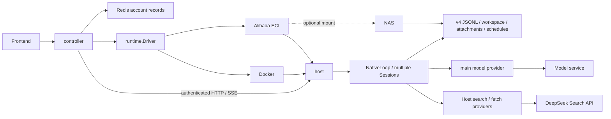

# Architecture

Each account opens a personal Host with multiple durable Agent sessions.
The Controller manages accounts and compute, and Redis stores the account
configuration and lifecycle state. The Host owns the agent runtime and filesystem.

## Source layout

| Directory | Responsibility |
|---|---|
| cmd/controller | Configuration, management CLI and external HTTP entry |
| cmd/host | Container process entry |
| harness | Native AgentLoop, v4 Session, assembly, tools and Agent features |
| internal/hostruntime | Multiple Sessions, child/fork lifecycle, replay and execution |
| internal/host | Host composition, skill initialization and readiness |
| internal/controller | Account lifecycle and streaming proxy |
| internal/httpapi | Authenticated session HTTP surface |
| internal/config, internal/localstate | Deployment configuration, private profile writes and local image-cache operation state |
| runtime, web | Small public capability interfaces and normalized types |
| providers/runtime | Docker and ECI implementations |
| providers/model, providers/web, providers/image | Model, search, page-fetch and image-generation implementations |
| thirdparty | Our integration code around external SDKs and HTTP APIs |
| client, examples | Go client and minimal frontend integration |
| build, harness/skills | Public Host image and bundled capabilities |
| tests/integration | Real Docker Host acceptance tests |

SDKs are resolved through Go modules. SDK request types remain inside thirdparty. Historical v1 helpers are only
under internal/testsupport and excluded from both production dependency graphs.

## Startup and identity

Controller loads the deployment profile and connects to Redis. Opening an
existing account starts or reconnects its Host. Controller saves the instance
ID before creating compute. Docker uses that ID in the container name.
ECI uses it as the client token and in resource tags so a retry can find the
same instance.

The driver supplies an address reachable from Controller. Docker
Hosts use dynamic published ports. ECI uses the private IP. After a successful
`/readyz` probe, Controller synchronizes model settings and saves the endpoint
in Redis for session forwarding and readiness checks.

The Host checks its startup configuration and writable filesystem operations
before listening. It uses the Controller-supplied account ID and runs one active writer per
Session, with durable inbox admission and one active turn at a time. Multiple
Sessions and tool calls can execute concurrently. The Host pins the selected
session model at the start of each turn. Child Agents inherit that turn's
model, and a fork creates another context branch within the same Host.

## Storage

The same native file I/O serves Docker volumes, ECI container storage and ECI
NAS.
The Host data root is `/root/harness`. Session journals live at
`$DSH_HOME/sessions/<project-key>/<session-id>/session.v4.jsonl`, where the
image sets `DSH_HOME=/root/harness/.dsh`. The project key comes from the
initial workspace path stored in the journal header's `cwd`. A manually created
session defaults to `/root/harness/workspaces/<session-id>`. Multiple sessions
can choose the same workspace, each with its own journal. Archiving preserves the
workspace and journal. Attachments live under `$DSH_HOME/attachments/v1`
and Host-wide schedules use `$DSH_HOME/storages/schedule.json`. Both user
skill roots also share the data root.
The Host installs initial OfficeCLI and agent-browser skills from the image on
first use of the data root.

One Controller manages the deployment and serializes lifecycle changes for
each account. ProcessClaims prevents duplicate Session activation inside a Host.

Replacement Docker containers mount the same named volume for the account.
Replacement ECI instances with NAS mount the account's NAS directory.
ECI container storage uses the instance's writable layer for its lifetime.

## Requests and lifecycle

The loopback controller proxies public Session and capability paths with the
internal Host token. It streams responses immediately and avoids replaying
an uncertain message POST. Session events have durable sequence
cursors; transient model fragments remain distinct. The internal Host shutdown
route is not exposed through this proxy.

Controller manages Host lifecycle through explicit requests. A stop request
waits for Docker to stop or ECI to be removed. Release retains the account
and external storage. Host owns its own schedule execution and stores the
model selection for sessions it creates alongside its durable data.

Model and search requests originate inside Host. Each client uses the key from
its own configuration. The controller validates the search provider and key
before launch. Public network fetches validate resolved targets.
The Host shell has the user's container-wide authority, including access to its
model/search keys and other Sessions. It is not a multi-tenant isolation layer.

See [configuration](configuration.md), [deployment](deployment.md),
[provider extension](providers.md) and [validation evidence](validation.md).
