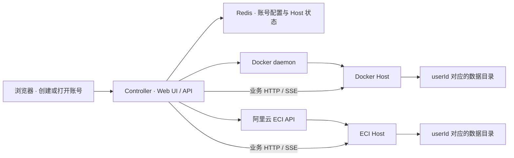

# Controller 容器化与 Redis 多 Host 方案

> 历史设计与调研记录。当前行为、配置和命令以[文档索引](README.md)中的指南为准。

模型端点与会话选择的数据结构以[模型设置方案](model-settings-and-session-routing-plan.zh-CN.md#redis-数据)为准。

## 启动与创建

一个 Compose 项目运行一个 Controller 和一个 Redis。Controller 托管 Web UI，并通过同一套接口创建、启动、停止和释放多个 Host。Docker Host 是 Controller 按需创建的独立容器。ECI Host 由 Controller 使用预先构建好的 `ImageCacheId` 创建。两种运行环境使用同一套 Host HTTP 接口。

`docker compose up -d` 启动 Controller 和 Redis。每次打开前端页面，先显示账号名输入框和「创建账号」入口。

1. **创建账号。** 账号身份只填自选的账号名（`userId`）。创建表单同时收集模型 API Key、URL 和模型名。Controller 检查必填项和 URL 格式，将账号写入 Redis，前端随后打开该账号。
2. **打开账号。** 用户输入已有账号名后，Controller 按 `userId` 查找记录，找到后启动 Host 或接回已有实例。页面显示启动进度，Host 就绪后进入聊天。账号不存在时显示提示，并提供创建入口。
3. **后续访问。** 再次打开同一账号时沿用已保存的模型配置和持久存储。每个账号同时最多有一个运行实例。

运行环境、存储、搜索和阿里云配置继续由部署者通过 `.env` 提供。Controller 启动时检查这部分配置。模型 API Key、URL 和模型名来自账号记录，在创建 Docker 或 ECI 实例时传给对应 Host，Responses 协议沿用代码默认。部署共用的网页搜索配置也来自 `.env`。切换运行环境或存储方式前，先释放旧配置下的实例。

## 标识与数据归属

| 字段 | 来源与生命周期 | 用途 |
|---|---|---|
| `userId` | 用户创建账号时选择，之后保持稳定。 | 索引账号记录，路由聊天请求，确定 NAS 子目录。 |
| `hostId` | Controller 在每次创建新运行实例前生成 UUID，并通过 `HOST_ID` 传给 Host。恢复同一个已停止的 Docker 容器沿用原值。释放实例后再次创建会得到新的值。 | 索引当前实例，也用于定位 Docker 容器或 ECI 资源。一次创建请求重试时复用同一个值，ECI 也用它作为 `ClientToken`。 |

例如，前端创建 `alice` 后打开账号，Controller 此时才分配 `hostId`。释放实例后再次打开账号会启动新实例，聊天入口和外部存储仍按 `alice` 定位。若使用容器可写层，释放实例也会释放其中的数据。

`userId` 使用 1 至 64 位小写字母、数字、下划线和连字符，首位为字母或数字。Docker 容器以 `hostId` 命名，ECI 用 `hostId` 标签查找。NAS 按 `userId` 分配目录，例如 `/go-harness/alice`。 [ECI 创建参数与 ClientToken](https://www.alibabacloud.com/help/en/eci/developer-reference/api-eci-2018-08-08-createcontainergroup)

## Redis 键与字段

每个账号使用一个无过期时间的 Redis Hash。例如账号 `alice` 使用 `user:alice`。账号 ID 直接取自键名。

| Hash 字段 | 类型 | 用途 |
|---|---|---|
| `desiredState` | 字符串 | Host 状态。创建账号时为 `stopped`，打开账号时设为 `running`，确认停止或释放后写回 `stopped`。 |
| `hostId` | 字符串 | 当前实例的 UUID，创建实例前写入，确认释放后清空。 |
| `hostToken` | 字符串 | Controller 调用 Host 的内部凭证，与 `hostId` 一起写入和清空。 |
| `hostEndpoint` | 字符串 | Host 就绪后保存 Controller 可访问的完整地址，含端口。停止或释放完成时清空。 |
| `llm` | JSON | 账号端点列表、各自的凭证和模型，以及默认端点。 |
| `webSearch`、`imageGeneration` | JSON | 各自的供应商配置与当前选择。 |
| `sessionModels` | JSON | 每个会话使用的端点和模型。 |
| `modelRevision` | 整数 | Controller 和 Host 同步模型设置所用的版本号。 |

创建账号用 Redis 事务检查键是否存在，再写入初始字段。Host 状态变更只更新相应字段。Docker 容器停止后保留 `hostId` 和 `hostToken`，实例释放后清空这两个字段并将 `desiredState` 设为 `stopped`。账号和设置继续保留。

Controller 直接读取账号记录进行转发。按 `hostId` 查询时，用请求里的 `X-User-ID` 读取同一条记录并核对实例 ID。状态接口直接探测保存地址的 `/readyz`。NAS 路径由 `userId` 派生。模型 API Key 和 `hostToken` 仅供 Controller 与对应 Host 使用，API 响应和日志中均省略这两项。

聊天日志、附件、工作区、技能和定时任务保存在 Host 文件系统。Docker 自动挂载按账号命名的卷，更换容器时沿用同一个卷。ECI 可以使用容器层或 NAS，启用 NAS 时新实例会重新挂载同一账号的目录。 [现有 Host 存储布局](deployment.md)

Redis 使用独立命名卷和 AOF，采用 `appendfsync always`。Controller 创建实例前先保存实例 ID，创建响应丢失时可以按同一个 ID 查找。Compose 同时把 Redis 端口发布到宿主机回环地址。 [Redis AOF 持久化](https://redis.io/docs/latest/management/persistence/)

## 生命周期与重启恢复

Controller 绑定 HTTP 端口，连接 Redis，检查所选运行环境所需的配置，随后提供账号页。每套安装运行一个 Controller 副本，同一宿主机端口由 Compose 的端口发布约束。Host 保留已有的数据目录保护。 [Docker 端口发布](https://docs.docker.com/engine/network/port-publishing/)

Controller 用进程内的互斥锁协调并发操作，用 Redis 保存账号和 Host 状态。生命周期操作会向运行时确认资源状态。

1. **打开账号时启动。** 找到账号后启动或接回 Host。同一个账号的并发请求复用同一次启动。新建实例时先保存 `running`、`hostId` 和 `hostToken`，再调用运行时。创建超时后先按 `hostId` 查找，重试也沿用同一个 ID。创建结果尚未确认时，先处理该次创建，再执行停止或释放。
2. **就绪。** Controller 用 `hostToken` 请求 `/readyz`，成功后保存 `hostEndpoint`。重新打开账号时优先验证并复用保存的地址。地址缺失或验证失败时，再向 Docker 或 ECI 查找。持久存储直接挂载由 `userId` 派生的专属路径。
3. **停止和释放。** 对当前 `hostId` 操作并等待运行时确认，再保存停止状态。Docker 停止后保留容器、ID 和凭证。ECI 停止或任一运行环境显式释放后，确认实例已不存在，再清空 ID 和凭证，并把目标状态归为 `stopped`。Redis 长期记录和外部存储保留，下次启动再分配 ID。
4. **重启恢复。** 已在运行的实例可用 Redis 保存的地址继续转发。用户可以重新提交失败或超时的停止或释放请求。需要新建或重启的实例等用户打开账号后再处理。Redis 无法确认写入结果时，该 Host 暂停后续生命周期操作，直到重新读到记录。

## 同步的手动生命周期

删除 72 小时回收规则。打开账号时仍按需启动 Host。用户关闭网页、断开 SSE 或长期不发消息时，Host 继续运行，后台 Job 和定时任务也可以继续执行。用户从侧栏点击 **Stop Host**，或调用同一个 Controller API，即可结束运行。仍在运行的 ECI 会继续产生计算费用。

| 操作 | Docker | ECI |
|---|---|---|
| **Stop Host** | 停止原容器，保留容器、Host ID 和数据卷 | 尝试优雅退出，再释放实例。NAS 数据保留，容器内存储随实例释放 |
| 再次打开账号 | 启动原容器 | 使用镜像缓存创建新实例。启用 NAS 时挂回原账号目录 |
| 显式删除实例 | 删除容器，保留账号数据卷 | 释放实例，保留外部存储 |

1. **删除 Controller 的后台循环。** 移除启动时注册的五分钟扫描、72 小时阈值、`lastActiveAt` 和只为记录活动时间而做的 Redis 写入。移除为闲置回收引入的 Host `drain`、`undrain` 调用及专用逻辑。手动停机和会话活动检查沿用各自的接口。
2. **在同一个请求内完成停止或释放。** Controller 保留账号级锁，调用 Docker 或 ECI 并在请求期限内核实结果。停止或释放成功前保留 Redis 的实例记录。确认成功且 Redis 状态已保存后返回成功。失败或期限内无法确认时返回相应错误，保留当前实例标识，以便用户主动重试时先查询该实例的实际状态。没有后台补偿，也不把失败的停机请求留到下一次打开账号时执行。打开账号照常根据该实例实际状态决定复用、启动原容器或创建新实例。
3. **在同一个请求内完成设置提交。** Host 在运行时，更新模型、搜索或生图设置的请求需要等 Redis 写入和 Host 应用都成功后才返回成功。Redis 保存成功但 Host 应用失败时，明确返回「已保存，当前 Host 应用失败」，用户可重新提交。去掉 `202 syncing` 和 `SyncPending`。Host 未运行时，保存设置就完成了请求，后续启动时加载 Redis 中的设置。
4. **Host 直接保存定时会话的模型选择。** 定时任务创建会话时，将所选模型保存在 Host 的持久化目录，后续运行仍使用该选择。移除向 Redis 扫描回写的流程。前端查看或切换该会话模型时，在对应请求中读写当前会话的选择；Controller 发送消息时也按同一选择校验。已有普通会话的 Redis 模型选择继续通过原入口管理。
5. **更新文档和验收。** 验证 Controller 启动及长时间运行均不扫描账号。覆盖手动停止成功、失败或超时、主动重试、运行中和未运行时保存设置，以及定时会话在 Host 重建后仍读取原模型选择。用真实 Docker 验证原容器可重启，用 ECI 驱动测试验证实例释放及 NAS 重挂。

## Compose 与访问边界

- **Controller。** Controller 镜像包含 Go 服务和嵌入式 Web UI。Compose 默认向宿主机发布 `127.0.0.1:8080`。Docker daemon 连接仅提供给 Controller，Host 镜像由 Controller 的部署配置指定。 [Controller Dockerfile](../build/Dockerfile.controller) · [Docker daemon 的访问边界](https://docs.docker.com/engine/security/)
- **Docker Host 端口。** Host 是 Compose 外的独立容器。Docker 为每个 Host 的容器端口 8080 分配不同的宿主机端口。Controller 查询该端口，通过 `host.docker.internal` 请求 Host。Redis 使用 Compose 内部网络。
- **ECI。** Controller 通过阿里云 API 创建实例，通过可达的 VPC 私网访问 Host。部署机器需要具备到该私网的路由。NAS 由 ECI 的存储配置按需启用。 [ECI 驱动](../providers/runtime/eci/driver.go)
- **账号入口。** 前端在当前页面保存选中的 `userId`，普通请求和 SSE 都通过 `X-User-ID` 传递账号名。刷新后回到账号页。账号名本身即可打开对应 Host，因此 Controller 入口用于本机或受信网络。

## API 与前端路由

| 接口 | 用途 |
|---|---|
| `POST /v1/accounts` | 提交账号名和模型配置以创建账号。账号已存在时返回 `409`。 |
| `GET /v1/host` | 查询当前账号的 Host 状态，供前端等待就绪。 |
| `GET /v1/hosts/{hostId}` | 按实例 ID 查询当前账号的 Host。实例已释放或不属于当前账号时返回 `404`。 |
| `POST /v1/host/start` | 按 `X-User-ID` 打开账号并启动或接回 Host。账号不存在时返回 `404`。启动失败后可用同一路由重试。 |
| `POST /v1/host/stop` | 停止当前账号的 Host。 |
| `DELETE /v1/host/instance` | 释放当前账号的计算实例，保留账号和外部存储。 |
| `/v1/sessions[/...]` | 按 `X-User-ID` 定位 Host，转发会话、消息、文件和 SSE。 |

## 实施与验收

1. 实现账号表单和 Redis 账号记录。并发创建同名账号时只接受一次。验证 Controller 启动时只提供账号页，打开已存在的账号才触发 Host 启动。
2. 接入 Controller 与 Redis 的 Compose 部署，更新 `.env.example`、启动脚本和 README，使 Controller 可以在尚无任何账号或模型配置时启动。验证 Controller 发布端口、各 Host 的动态端口和 Controller 重建后的实例重连，并确认 Redis 仍在内部网络。
3. 分别打开两个使用不同模型配置的账号，验证 Docker 和 ECI 启动时只接收对应账号的配置。验证同账号并发打开复用同一个实例，聊天、附件和 SSE 路由到选中账号的 Host。
4. 验证 Controller 和 Redis 重启后等待用户打开账号再启动或接回实例、释放实例后旧 `hostId` 失效、同一账号的新实例挂回原有外部存储，以及 Redis 写入失败时的行为。用模拟 ECI 验证创建超时后复用 `hostId`，有云环境时补验真实 ECI、无 NAS 启动和 NAS 重挂。
5. 验证 Docker 停止后保留原容器，以及 ECI 删除确认、超时、主动重试和 Redis 状态清理。
